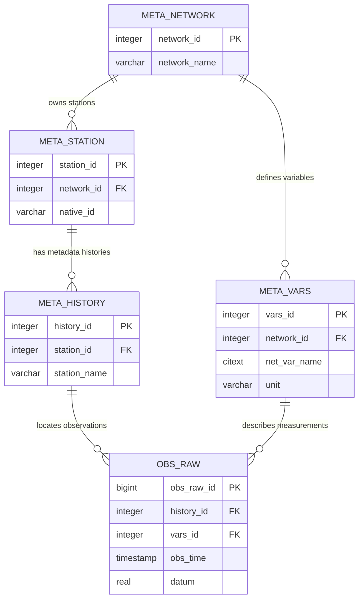

# PCDS database structure

This is a working reference for the `crmp` PostgreSQL/PostGIS schema used by the PCDS code in this repository. It focuses on the five core tables seen in day-to-day observation queries.

Sources used:

- SQL supplied with this documentation request.
- The repository's cached database metadata in `.idea/dataSources/5659a3c0-99d6-4199-9dd8-51373671d4eb.xml`.

The cached metadata is a snapshot, so confirm it against the live database before doing migrations or destructive work.

## Mental model

PCDS stores observations in a normalized hierarchy:



The usual path for reading an observation with full context is:

```text
meta_network -> meta_station -> meta_history -> obs_raw <- meta_vars <- meta_network
```

`meta_station` and `meta_vars` each point to a network independently. For a valid observation these normally describe the same source network, but queries can compare `s.network_id` with `v.network_id` to detect inconsistencies.

## Core tables

### `meta_network` — source/owner network

One row represents an observing network, such as `BC-FWx` or `BC-Air`.

| Column | Type | Meaning |
|---|---|---|
| `network_id` | integer, PK | Internal network identifier; populated by `network_id_seq`. |
| `network_name` | varchar(255) | Stable network name/code. A trigger in the cached schema prevents modification. |
| `description` | varchar(255) | Human-readable description. |
| `virtual` | varchar(255) | Virtual-network metadata. |
| `publish` | boolean | Whether the network is publishable. |
| `col_hex` | varchar(7) | Display colour. |
| `contact_id` | integer, FK | Network contact in `meta_contact`. |
| `network_display_name` | varchar, unique | User-facing display name. |
| `mod_time` | timestamp | Audit timestamp; defaults to `now()`. |
| `mod_user` | varchar(64) | Audit user; defaults to `CURRENT_USER`. |

Relationships: one network has many stations and many variable definitions.

### `meta_station` — stable station identity

One row represents a station identity within a network. Location and name are deliberately kept in `meta_history`, because they may change over time.

| Column | Type | Meaning |
|---|---|---|
| `station_id` | integer, PK | Internal stable station identifier. |
| `network_id` | integer, FK | Owning network (`meta_network.network_id`). |
| `native_id` | varchar(255) | Station identifier supplied by the source network. |
| `min_obs_time` | timestamp | Cached earliest observation time. |
| `max_obs_time` | timestamp | Cached latest observation time. |
| `publish` | boolean, not null | Publication flag; defaults to `true`. |
| `mod_time` | timestamp | Audit timestamp. |
| `mod_user` | varchar(64) | Audit user. |

Important: `native_id` is not shown as globally unique in the cached schema. Treat `(network_id, native_id)` as the practical lookup context, and check for duplicates when necessary.

### `meta_history` — time-varying station metadata

A station can have multiple history rows. Each row captures a version/period of station metadata, and observations attach to the applicable history row rather than directly to the station.

| Column | Type | Meaning |
|---|---|---|
| `history_id` | integer, PK | Metadata-history identifier. |
| `station_id` | integer, FK | Parent station (`meta_station.station_id`). |
| `station_name` | varchar(255) | Station name for this history record. |
| `lon`, `lat`, `elev` | numeric | Longitude, latitude, and elevation. |
| `sdate`, `edate` | date | Start/end dates for this metadata version. |
| `tz_offset` | interval | Station time-zone offset. |
| `province`, `country` | varchar | Administrative location. |
| `comments` | varchar(255) | Free-text notes. |
| `the_geom` | geometry(Geometry, 4326) | PostGIS geometry in WGS 84. Conventionally, X = longitude and Y = latitude. |
| `sensor_id` | integer, FK | Optional sensor/element reference. |
| `freq` | `timescale` | Observation frequency/custom timescale. |
| `mod_time`, `mod_user` | timestamp, varchar | Audit fields. |

Coordinates exist in both scalar (`lat`, `lon`) and spatial (`the_geom`) form. They can drift out of sync, so spatial-quality queries should compare `ST_X(the_geom)` with `lon` and `ST_Y(the_geom)` with `lat` (with suitable null/tolerance handling).

### `meta_vars` — network-specific variable dictionary

One row defines a measured variable as named by a particular network.

| Column | Type | Meaning |
|---|---|---|
| `vars_id` | integer, PK | Internal variable identifier. |
| `network_id` | integer, FK | Network that defines the variable. |
| `unit` | varchar(64) | Measurement unit. |
| `precision` | numeric | Expected precision. |
| `standard_name` | varchar(64), not null | Standardized variable name. |
| `cell_method` | varchar(64), not null | Temporal/statistical method (for example point, mean, or sum semantics). |
| `long_description` | varchar(256) | Detailed description. |
| `net_var_name` | case-insensitive text | Native variable name used by the network. |
| `display_name` | varchar(256), not null | User-facing label. |
| `short_name` | varchar(256) | Short label. |
| `mod_time`, `mod_user` | timestamp, varchar | Audit fields. |

The pair `(network_id, net_var_name)` is unique. `net_var_name` is case-insensitive and constrained to identifier-like text.

### `obs_raw` — observation fact table

This is the large fact table. A row is one value for one station-history context, one variable, and one observation time.

| Column | Type | Meaning |
|---|---|---|
| `obs_raw_id` | bigint, PK | Surrogate observation identifier. |
| `obs_time` | timestamp | Time represented by the observation. |
| `datum` | real | Numeric observed value. |
| `history_id` | integer, FK | Station metadata context (`meta_history.history_id`). |
| `vars_id` | integer, FK, not null | Variable definition (`meta_vars.vars_id`). |
| `mod_time` | timestamp, not null | Time the database row was changed; not the observation time. |
| `mod_user` | varchar(64), not null | User/process that changed the row. |

The database has a unique constraint on `(history_id, vars_id, obs_time)`, preventing duplicate measurements for the same station-history, variable, and time.

## Key relationships

| Child column | Parent column | Cardinality/purpose |
|---|---|---|
| `meta_station.network_id` | `meta_network.network_id` | Many stations belong to one network. |
| `meta_history.station_id` | `meta_station.station_id` | A station can have multiple metadata histories. |
| `meta_vars.network_id` | `meta_network.network_id` | A network defines many native variables. |
| `obs_raw.history_id` | `meta_history.history_id` | Observations use a specific metadata version. |
| `obs_raw.vars_id` | `meta_vars.vars_id` | Observations use a specific variable definition. |

## Standard query pattern

```sql
SELECT
    n.network_name,
    s.native_id,
    h.station_name,
    h.lat,
    h.lon,
    v.net_var_name,
    v.standard_name,
    v.unit,
    o.obs_time,
    o.datum
FROM crmp.obs_raw AS o
JOIN crmp.meta_history AS h ON h.history_id = o.history_id
JOIN crmp.meta_station AS s ON s.station_id = h.station_id
JOIN crmp.meta_network AS n ON n.network_id = s.network_id
JOIN crmp.meta_vars AS v ON v.vars_id = o.vars_id
WHERE s.network_id = :network_id
  AND s.native_id = :native_id
ORDER BY o.obs_time;
```

Use explicit `crmp.` qualification when the session's `search_path` is not guaranteed.

## Identifier guide

- `network_id`: internal source-network identity.
- `station_id`: stable internal station identity.
- `native_id`: the source network's station identifier; always interpret it with its network.
- `history_id`: one version/period of station metadata; this is what `obs_raw` references.
- `vars_id`: one network-specific variable definition.
- `obs_raw_id`: one stored observation row.
- `obs_time`: when the measurement applies.
- `mod_time`: when the database row was inserted or modified.

## Operational cautions

- A station is not identified safely by `station_name` alone; names live in history and can repeat or change. Prefer `station_id`, or `(network_id, native_id)` for source-facing work.
- Do not assume a station has exactly one `meta_history` row. A scalar subquery for `history_id` can fail when multiple histories exist.
- Filtering only on `native_id` can mix networks. Include `network_id` unless cross-network matching is intentional.
- Filtering on `mod_time::date = CURRENT_DATE` describes rows changed today, not observations measured today. Use `obs_time` for measurement periods.
- Date casts on indexed timestamps can inhibit efficient index use. For a day, prefer a half-open range such as `mod_time >= :day AND mod_time < :day + INTERVAL '1 day'`.
- Before deleting a station, inspect and remove or reassign dependent `obs_raw` rows, then `meta_history`, then `meta_station`, subject to the live foreign-key rules. Always run the matching `SELECT COUNT(*)` first and use a transaction.
- The schema has audit/history companions such as `meta_network_hx`, `meta_station_hx`, `meta_history_hx`, `meta_vars_hx`, and `obs_raw_hx`; triggers on the primary tables appear to populate them for inserts, updates, and deletes.
- Related flag tables include `obs_raw_native_flags` and `obs_raw_pcic_flags`, both linked through `obs_raw_id`.

## Useful integrity checks

Find observations whose station network and variable network disagree:

```sql
SELECT COUNT(*) AS mismatched_observations
FROM crmp.obs_raw AS o
JOIN crmp.meta_history AS h ON h.history_id = o.history_id
JOIN crmp.meta_station AS s ON s.station_id = h.station_id
JOIN crmp.meta_vars AS v ON v.vars_id = o.vars_id
WHERE s.network_id IS DISTINCT FROM v.network_id;
```

Find duplicate native station IDs within a network:

```sql
SELECT network_id, native_id, COUNT(*) AS station_count
FROM crmp.meta_station
GROUP BY network_id, native_id
HAVING COUNT(*) > 1
ORDER BY network_id, native_id;
```

Find stations with multiple history rows:

```sql
SELECT station_id, COUNT(*) AS history_count
FROM crmp.meta_history
GROUP BY station_id
HAVING COUNT(*) > 1
ORDER BY history_count DESC;
```

## Scope

PCDS contains more tables than this guide covers (contacts, sensors/elements, flags, derived values, history/audit tables, views, and materialized views). The five tables above form the core structure needed to understand the supplied SQL and most raw-observation queries.
